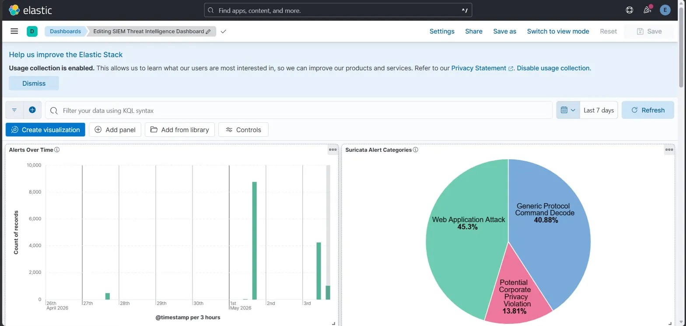
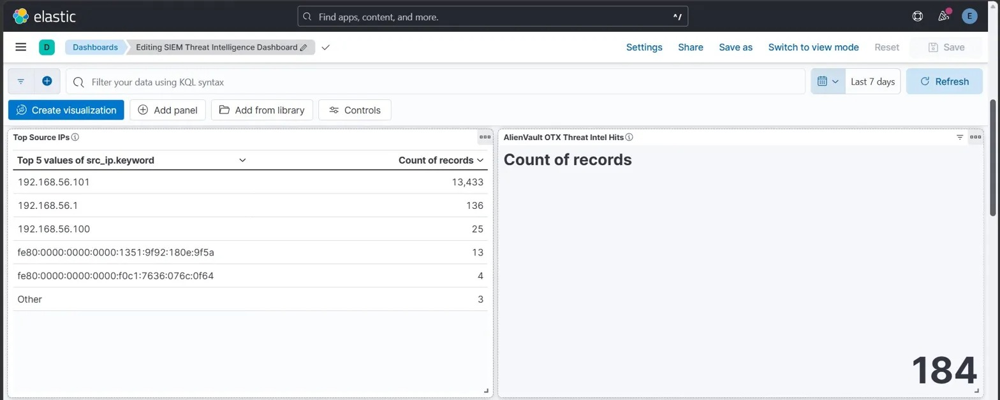
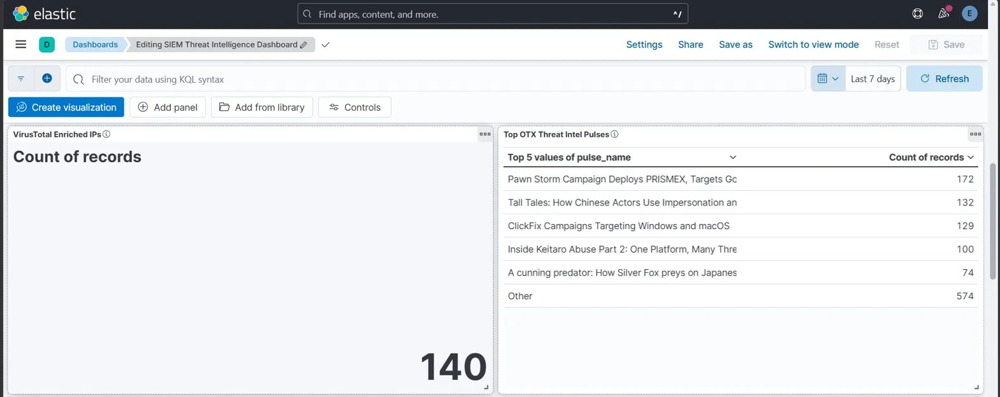
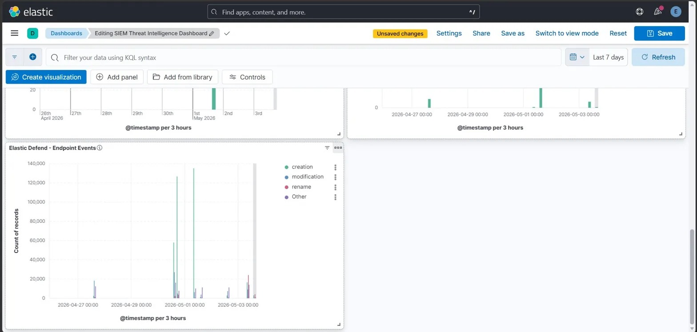
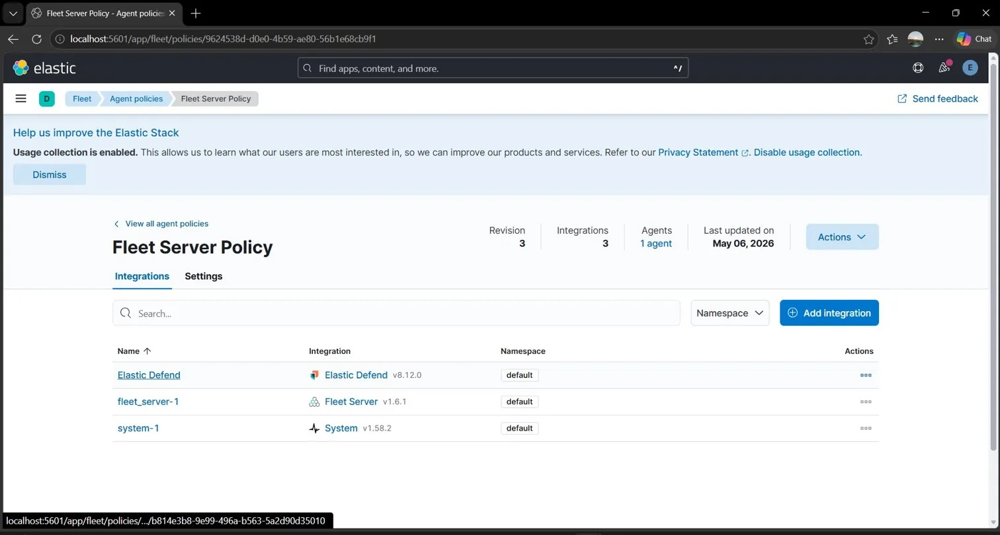
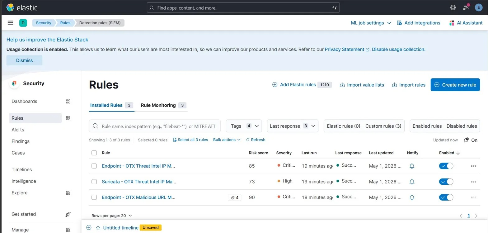

# Elastic Stack SOC Lab — Security Monitoring & Detection

A hands-on Security Operations Center (SOC) lab using the Elastic Stack to collect and search logs, explore Kibana dashboards, and practice SIEM detection-rule workflows.

> **Project note:** This repository contains configuration examples, a Kibana saved-object export, custom rule definitions, and screenshots from the lab. Update machine-specific paths and validate the configurations against your own Elastic Stack version before running them. The included Logstash pipeline reads a local test log and sends events to Elasticsearch; external threat-intelligence enrichment requires additional pipeline/API configuration and the relevant threat-intelligence indices.

## Project Overview

The lab is intended to demonstrate core SOC workflows:

- Centralized log ingestion and search with Elasticsearch and Logstash
- Security monitoring and visualization in Kibana
- Review and export of dashboards and detection-rule definitions
- Practice investigating authentication, process, web, and network-related events
- Exploration of threat-intelligence matching concepts through rule definitions

## Architecture

```text
Local test log / configured log sources
                 |
                 v
              Logstash
          (input / pipeline)
                 |
                 v
           Elasticsearch
       (index and search events)
                 |
                 v
               Kibana
   (dashboards / saved objects / rules)

Additional lab components:
- Elastic Agent / Fleet configuration notes
- Apache Filebeat module configuration
- Detection-rule definitions referencing security and threat-intelligence data
```

## Tools & Technologies

| Tool / Component | Role in the project |
|---|---|
| Elasticsearch | Stores, indexes, and searches event data |
| Kibana | Dashboards, saved objects, and SIEM investigation interface |
| Logstash | Reads configured log input, processes events, and forwards them to Elasticsearch |
| Elastic Agent / Fleet | Endpoint collection and agent-management component in the lab |
| Filebeat Apache module | Example configuration for Apache access logs |
| NDJSON exports | Portable Kibana dashboard and detection-rule artifacts |

The uploaded configuration references Elastic Stack **9.2.3** in some project documentation. Confirm the exact installed version in your environment before importing or running files.

## Repository Structure

```text
ElasticStack-SOC-Lab/
├── configs/
│   ├── elasticsearch.yml
│   ├── kibana.yml
│   ├── logstash.conf
│   ├── logstash.yml
│   ├── pipelines.yml
│   ├── elastic-agent.yml
│   └── apache.yml
├── dashboards/
│   └── kibana-dashboard.ndjson
├── rules/
│   └── elastic_custom_rules.ndjson
├── screenshots/
│   ├── dashboard.jpeg
│   ├── dash2.jpeg
│   ├── dash3.jpeg
│   ├── dash4.jpeg
│   ├── fleet.jpeg
│   ├── fleet server.jpeg
│   ├── log 1.jpeg
│   ├── log 2.jpeg
│   └── rules.jpeg
├── scripts/
├── .env.example
├── .gitignore
└── README.md
```

## Screenshots

### Kibana Dashboard



### Additional Dashboard Views







### Fleet




### Log Investigation and Detection Rules




## Configuration Guide

### 1. Prerequisites

- A working Elasticsearch and Kibana installation
- Logstash for the included pipeline
- Optional: Elastic Agent/Fleet and Filebeat if using the corresponding collection configurations
- Windows paths in the sample configs must be adjusted to match your environment

### 2. Configure credentials safely

Copy `.env.example` to `.env` as a reference for the values you need. Set environment variables in the shell or service environment used to start Elastic components. Do **not** commit `.env`, API keys, passwords, service tokens, certificates, or private keys.

The included YAML files use environment-variable placeholders for sensitive Kibana and Elasticsearch credentials. Check the variable names and supported configuration syntax for your installed version before starting the services.

### 3. Configure the Logstash input

Open `configs/logstash.conf` and update the input `path` to point to a test log file on your computer. The current example is Windows-specific and uses a local file input. You can use `sample-data/soc-test.log` as a harmless sample, but change the path in the config to its absolute path on your machine.

Confirm that:
- The configured input file exists and contains test events.
- The Elasticsearch URL is correct.
- `ES_USER` and `ES_PASSWORD` are set in the process environment if authentication is enabled.
- The index naming pattern suits your lab.

### 4. Start the services

Start Elasticsearch and Kibana using the startup method for your installation. Then validate and run the Logstash pipeline from your Logstash installation directory. For example, on Windows:

```powershell
.\bin\logstash.bat -f "C:\path\to\project\configs\logstash.conf"
```

Replace the example path with the actual location of this repository. Use the official Elastic documentation for version-specific installation and service commands.

### 5. Import the Kibana dashboard

1. Open Kibana.
2. Navigate to **Stack Management → Saved Objects**.
3. Choose **Import**.
4. Select `dashboards/kibana-dashboard.ndjson`.
5. Review any import conflicts or missing dependencies.

The dashboard export may depend on data views, index patterns, or integrations from the original lab. Create or adjust those dependencies if Kibana reports that they are missing.

### 6. Review detection-rule definitions

The file `rules/elastic_custom_rules.ndjson` contains rule definitions for use as a reference. Review and adapt each rule to the data sources, index patterns, fields, and rule schema supported by your Kibana version before importing or enabling it.

Some rules reference threat-intelligence indices (for example, OTX-related indices). Those rules will not produce meaningful matches unless the corresponding indices are populated and the fields align with the rule configuration. Validate rules in a test environment before enabling alerting.

## Example Detection Use Cases

The rule definitions in this repository cover or reference examples such as:

- Repeated failed Windows logons
- Suspicious PowerShell command lines
- Office applications spawning command shells
- Suspicious web requests / HTTP error patterns
- Network activity and port-scan investigation
- Matching events against threat-intelligence indicators
- Potential ransomware-related command patterns
- USB-related file activity

These are starting points for lab practice, not a guarantee that every rule is production-ready. Tune thresholds and queries to your actual telemetry to reduce false positives.

## Security & Safety Notes

- Never upload real credentials, API keys, service tokens, private keys, or sensitive logs to a public repository.
- Use synthetic or sanitized events for demonstrations.
- Do not test detections against systems you do not own or have explicit permission to assess.
- Treat detection rules as examples: test and validate them before using them in a live environment.

## Learning Outcomes

This project can be used to demonstrate familiarity with:

- Elastic Stack components and their roles in a SOC workflow
- Log ingestion and basic pipeline configuration
- Kibana dashboards and saved-object exports
- Detection-rule concepts and index/query dependencies
- Troubleshooting configuration paths, authentication, and data visibility

## References

- [Elastic Security documentation](https://www.elastic.co/guide/en/security/current/index.html)
- [Elasticsearch documentation](https://www.elastic.co/guide/en/elasticsearch/reference/current/index.html)
- [Kibana documentation](https://www.elastic.co/guide/en/kibana/current/index.html)
- [Logstash documentation](https://www.elastic.co/guide/en/logstash/current/index.html)
- [Elastic Fleet documentation](https://www.elastic.co/guide/en/fleet/current/index.html)
- [AlienVault OTX](https://otx.alienvault.com)
- [VirusTotal API documentation](https://docs.virustotal.com/reference/overview)
- [MITRE ATT&CK](https://attack.mitre.org)

---

**Built as a hands-on learning project for SOC monitoring, SIEM investigation, and detection engineering practice.**
